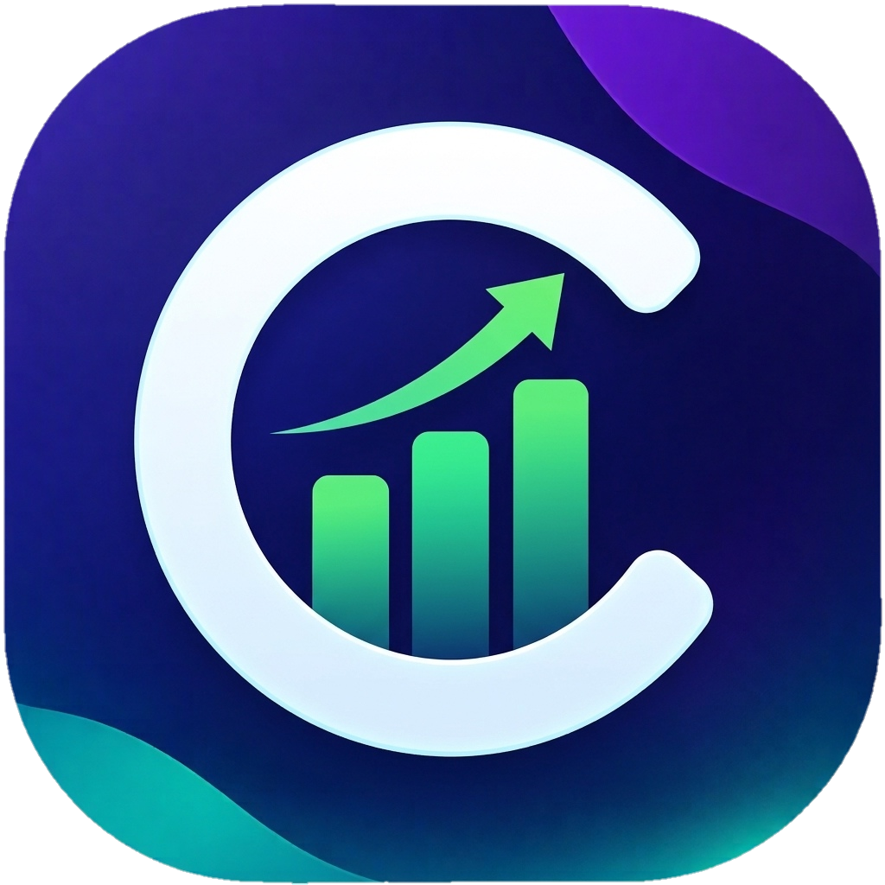
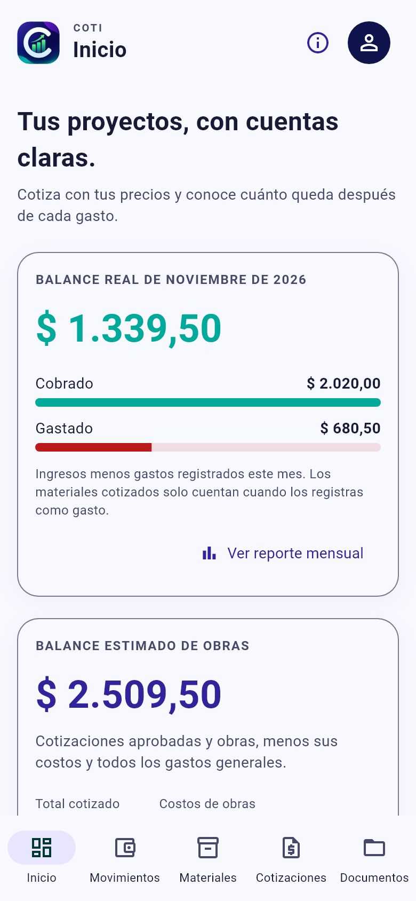
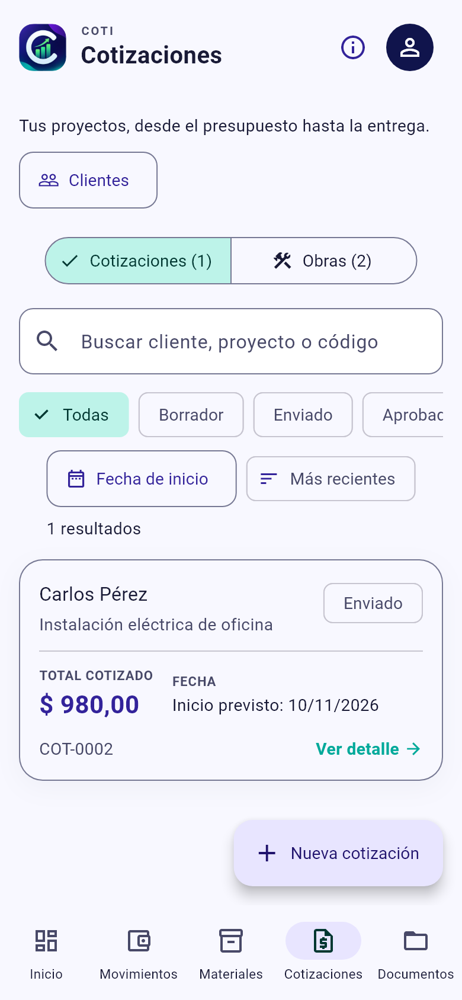
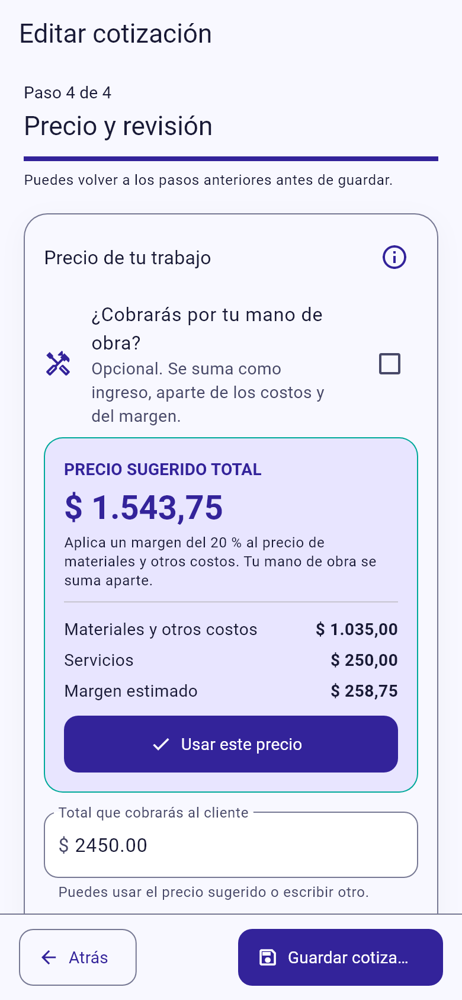
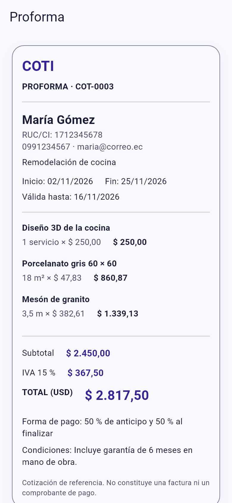
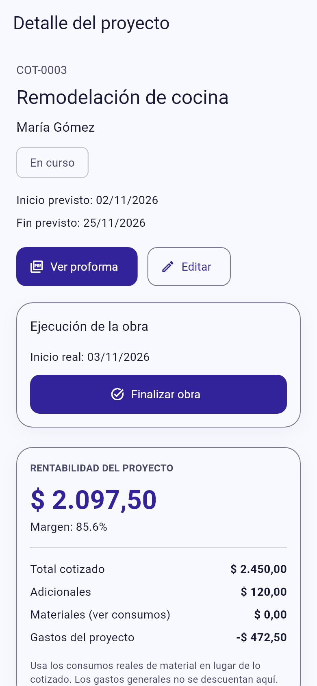
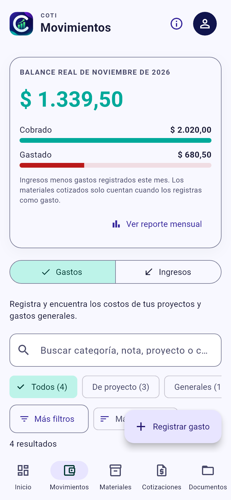
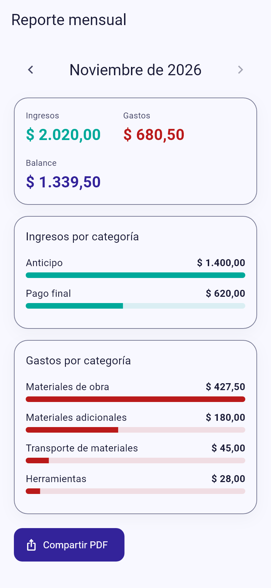
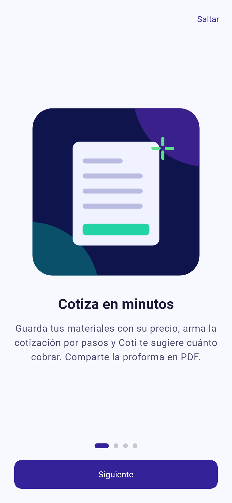
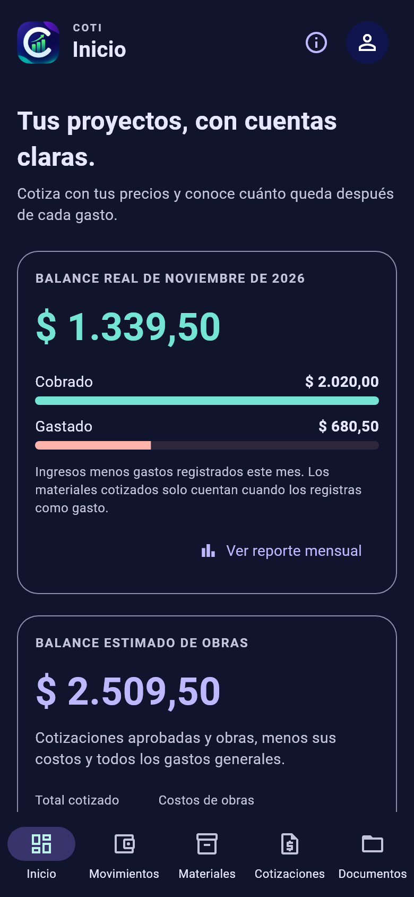

<p align="center">
  
</p>

<h1 align="center">Coti</h1>

<p align="center">
  <strong>Cotiza, controla y crece.</strong><br>
  Cotizaciones, gastos, cobros y ganancias de tus trabajos, en tu teléfono y sin internet.
</p>

<p align="center">
  <a href="https://github.com/AndresBerre23/COTIZO-APP/releases/latest"></a>
</p>

<p align="center">
  
  
  
  
  
</p>

---

Coti está hecha para emprendedores y profesionales independientes (albañiles, electricistas, pintores, carpinteros y cualquiera que cotice trabajos) que necesitan saber cuánto cobrar, cuánto gastaron y cuánto les queda, sin hojas de cálculo ni cuentas en la nube.

## Capturas

<table>
  <tr>
    <td align="center"><br><sub>Balance real del mes</sub></td>
    <td align="center"><br><sub>Cotizaciones y obras</sub></td>
    <td align="center"><br><sub>Precio sugerido con tu margen</sub></td>
  </tr>
  <tr>
    <td align="center"><br><sub>Proforma con IVA para el cliente</sub></td>
    <td align="center"><br><sub>Rentabilidad de cada obra</sub></td>
    <td align="center"><br><sub>Ingresos y gastos</sub></td>
  </tr>
  <tr>
    <td align="center"><br><sub>Reporte mensual en PDF</sub></td>
    <td align="center"><br><sub>Tutorial de bienvenida</sub></td>
    <td align="center"><br><sub>Modo oscuro</sub></td>
  </tr>
</table>

## Funciones

### Cotizar
- Catálogo de materiales con unidad, precio y foto (cámara, galería o Wikimedia Commons).
- Asistente de cotización en 4 pasos: cliente, materiales y servicios, gastos previstos y precio.
- Precio sugerido con tu propio margen; cobro de mano de obra aparte.
- Proforma en PDF lista para compartir: tu logo y datos, datos del cliente, IVA (15 %, 0 % o sin IVA para RIMPE), validez, forma de pago y condiciones.
- El cliente ve solo precios finales: tus costos y tu margen nunca salen en el PDF.
- Lista de clientes reutilizable.

### Controlar la obra
- Iniciar y finalizar obras, con aviso de retraso.
- Consumo real de materiales frente a lo cotizado: sobrecosto o ahorro.
- Adicionales con su propia orden de cambio en PDF.
- Versiones de la proforma: si editas una ya enviada, la anterior se conserva.
- Fotos del avance y del resultado, optimizadas, con galería por obra y para compartir por WhatsApp.

### Saber cuánto ganas
- Cobros (anticipos, abonos y pago final) con saldo pendiente y devoluciones.
- Balance real del mes: lo cobrado menos lo gastado.
- Reporte mensual por categoría en PDF.
- Rentabilidad de cada obra y reporte de cierre.

### Tus datos, seguros
- Todo vive en tu teléfono (SQLite) y funciona sin internet. No necesita cuenta.
- Respaldo y restauración en un archivo .zip.
- Bloqueo opcional con huella o con la clave del teléfono.
- Una obra con dinero registrado no se borra: se cancela y conserva su historial.

## Descarga

Descarga el APK desde la [última versión](https://github.com/AndresBerre23/COTIZO-APP/releases/latest):

| Archivo | Para |
| --- | --- |
| `coti-1.0.0-arm64.apk` | La mayoría de teléfonos Android actuales (recomendado). |
| `coti-1.0.0-armv7.apk` | Teléfonos antiguos de 32 bits. |

Para instalarlo, abre el archivo en tu teléfono y permite la instalación desde esa fuente si Android lo pide. Pronto estará en Google Play.

## Tecnología

| | |
| --- | --- |
| Interfaz | Flutter 3.32 y Material 3, adaptable a teléfono, tablet y escritorio |
| Estado | BLoC/Cubit (`flutter_bloc`) |
| Datos | SQLite (`sqflite`), con migraciones versionadas |
| Documentos | `pdf` y `printing` |
| Seguridad | `local_auth` (huella o clave del teléfono) |
| Pruebas | 115 pruebas de dominio, datos y pantallas |

El código está organizado por funcionalidad (`lib/funcionalidades/<modulo>/`), con el dominio y la persistencia separados. El detalle está en [docs/ARQUITECTURA.md](docs/ARQUITECTURA.md).

## Desarrollo

Requisitos: Flutter 3.32 o superior y Android SDK.

```sh
flutter pub get
flutter analyze
flutter test
flutter run
```

Para compilar los APK de prueba:

```sh
flutter build apk --release --split-per-abi
```

Para publicar en Google Play, sigue [docs/PUBLICACION.md](docs/PUBLICACION.md). La clave de firma va en `android/key.properties`, que nunca se sube al repositorio.

Las capturas de este README se generan con datos de ejemplo, sin información real.

## Documentación

- [docs/contexto/](docs/contexto/LEEME.md): estado del producto, pendientes, decisiones y bitácora de cambios.
- [docs/ARQUITECTURA.md](docs/ARQUITECTURA.md): estructura, entidades y reglas de cálculo.
- [docs/VERIFICACION.md](docs/VERIFICACION.md): pruebas y verificaciones realizadas.
- [DESIGN.md](DESIGN.md): sistema visual.

## Autor

Desarrollado por [@AndresBerre23](https://github.com/AndresBerre23).
